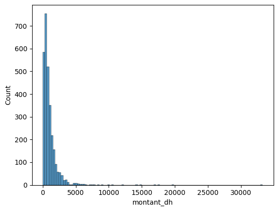
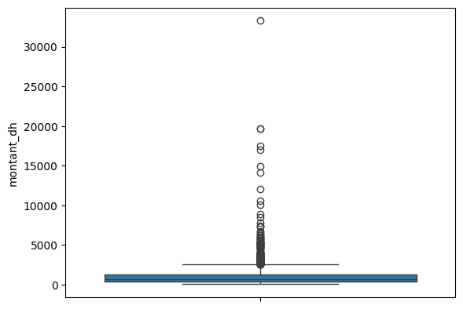
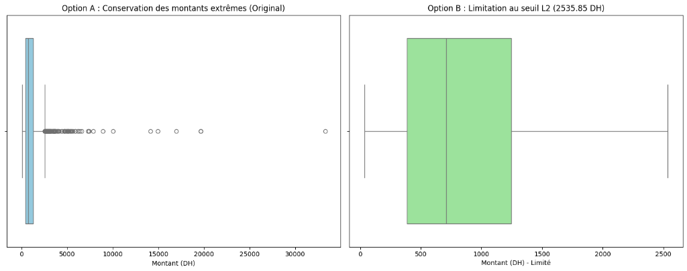
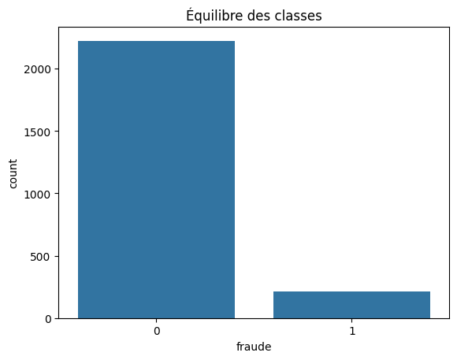
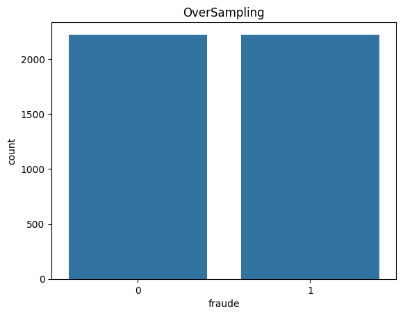
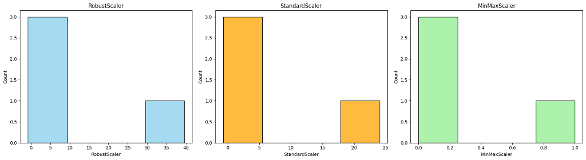

# Prétraitement d'un Dataset de Transactions Bancaires & Détection de Fraude

## 📋 Aperçu du Projet

Ce projet propose un pipeline complet et rigoureux de **prétraitement des données (Data Preprocessing)** appliqué à un jeu de données de **transactions financières et de détection de fraude bancaire**. 

Dans les projets de Machine Learning appliqués à la finance, les données brutes comportent des défis majeurs :
- **Valeurs manquantes et doublons techniques** ;
- **Distributions asymétriques à forte queue** avec des montants extrêmes (outliers) ;
- **Variables catégorielles hétérogènes** (canaux, appareils, régions géographiques) ;
- **Fort déséquilibre de classes** (les fraudes représentent une minorité des transactions) ;
- **Risques critiques de fuite d'information (*Data Leakage*)**, notamment par la présence de variables post-incident ou le calcul de paramètres de normalisation avant le découpage train/test.

L'objectif de ce projet est de concevoir un pipeline robuste, modulaire et sérialisable, prêt pour la mise en production.

---

## 📊 Description du Dataset

Le dataset `transactions-dataset.csv` recense des opérations bancaires détaillées :

| Colonne | Type | Rôle / Description |
| :--- | :--- | :--- |
| `id_operation` | Catégorique (Identifiant) | Identifiant unique de l'opération (clé technique arbitraire). |
| `id_client` | Catégorique (Identifiant) | Identifiant unique du client bancaire. |
| `montant_dh` | Numérique continu | Montant de la transaction en Dirhams marocains (DH). |
| `anciennete_mois`| Numérique continu | Ancienneté du compte client en mois. |
| `nb_ops_24h` | Numérique discret | Nombre d'opérations effectuées par le client sur les dernières 24h. |
| `heure` | Numérique discret | Heure de la journée à laquelle la transaction a eu lieu (0 à 23). |
| `canal` | Catégoriel | Canal utilisé : `application`, `site_web`, `agence`, `telephone`. |
| `appareil` | Catégoriel | Terminal utilisé : `mobile`, `ordinateur`, `terminal`. |
| `region` | Catégoriel | Région : `Casablanca-Settat`, `Marrakech-Safi`, `Souss-Massa`, `Draa-Tafilalet`, `Autre`. |
| `international` | Catégoriel binaire | Indique si l'opération a une composante internationale (`oui` / `non`). |
| `resultat_enquete`| Catégoriel (Post-incident) | Conclusion de l'enquête humaine (`aucune_fraude`, `fraude_confirmee`). |
| `fraude` | Binaire (0 ou 1) | **Variable cible ($y$)** à prédire ($1 = \text{Fraude}$, $0 = \text{Légitime}$). |

---

## 🛠️ Étapes Méthodologiques de Prétraitement

### 1. Diagnostic Initial, Nettoyage & Prévention du Data Leakage

1. **Suppression des doublons** :
   - Recherche systématique des répétitions sur `id_operation` et élimination des doublons pour éviter le surapprentissage d'opérations dupliquées.
2. **Gestion des valeurs manquantes** :
   - Identification des colonnes présentant des valeurs nulles (`montant_dh`, `anciennete_mois`, `nb_ops_24h`, `canal`, `appareil`, `region`).
3. **Exclusion des identifiants et des variables de fuite (*Target / Data Leakage*)** :
   - **`id_operation` et `id_client`** sont exclus : ce sont des clés arbitraires sans pouvoir prédictif généralisable.
   - **`resultat_enquete`** est strictement retiré des variables d'entrée ($X$) : cette information n'est connue **qu'après** l'enquête menée suite à la transaction. L'inclure donnerait directement la réponse au modèle (100% de précision artificielle à l'entraînement, mais inutilisable en temps réel).

---

### 2. Analyse de la Distribution et Gestion des Valeurs Extrêmes (*Outliers*)

La variable financière `montant_dh` présente une forte asymétrie droite avec des transactions de plusieurs milliers de DH alors que le cœur des transactions se situe sous les 1200 DH :

| Distribution du Montant | Boxplot des Valeurs Extrêmes |
| :---: | :---: |
|  |  |

#### Calculs statistiques IQR :
- **$Q_1$ (25e percentile)** : $384.27\text{ DH}$
- **Médiane (50e percentile)** : $706.80\text{ DH}$
- **$Q_3$ (75e percentile)** : $1244.90\text{ DH}$
- **$\text{IQR} = Q_3 - Q_1$** : $860.63\text{ DH}$
- **Seuil haut ($L_2 = Q_3 + 1.5 \times \text{IQR}$)** : $2535.85\text{ DH}$

#### Arbitrage Métier : Option A vs Option B

| Option A : Conservation des montants d'origine | Option B : Écrêtage au seuil $L_2$ (2535.85 DH) |
| :---: | :---: |
|  |

- **Pourquoi les montants extrêmes ne sont pas de simples erreurs ?**
  En milieu bancaire, des montants élevés correspondent souvent à des achats légitimes majeurs ou au contraire à des attaques frauduleuses ciblées. Supprimer ces lignes masquerait le signal d'alerte.
- **Décision** : Utiliser un scaler robuste (**RobustScaler**) qui permet de conserver l'information des montants réels (Option A) sans laisser les outliers déformer la mise à l'échelle des transactions ordinaires.

---

### 3. Comparaison des Méthodes de Normalisation / Mise à l'Échelle

Trois stratégies ont été comparées sur les variables continues :



1. **StandardScaler ($\frac{x - \mu}{\sigma}$)** :
   - Très sensible aux valeurs extrêmes : $\mu$ et $\sigma$ sont tirés vers le haut, écrasant les transactions ordinaires près de zéro.
2. **MinMaxScaler ($\frac{x - x_{min}}{x_{max} - x_{min}}$)** :
   - Fortement contraint par le montant maximal (> 30 000 DH), comprimant l'immense majorité des données dans un intervalle étroit $[0, 0.1]$.
3. **RobustScaler ($\frac{x - \text{médiane}}{\text{IQR}}$) — Choix Retenu** :
   - La médiane et l'IQR étant insensibles aux outliers, l'échelle reste stable et représentative de la majorité des transactions normales (médiane fixée à 0).

---

### 4. Gestion du Déséquilibre des Classes

Dans le jeu de données, les transactions frauduleuses sont minoritaires (~10% de fraudes) :

| Classes Initiales | Répartition dans l'échantillon d'entraînement | Équilibrage par OverSampling |
| :---: | :---: | :---: |
|  |  |  |

- **Traitement** : Utilisation de techniques de sur-échantillonnage (*RandomOverSampler* ou *SMOTE-NC*) appliquées **uniquement sur l'ensemble d'entraînement (`X_train`)** pour éviter la contamination du jeu de test.

---

### 5. Pipeline Final & Sérialisation Scikit-Learn

Le prétraitement complet est encapsulé dans un `ColumnTransformer` scikit-learn :
- **Branche Numérique** : `SimpleImputer(strategy='median')` $\rightarrow$ `RobustScaler()`
- **Branche Catégorielle** : `SimpleImputer(strategy='most_frequent')` $\rightarrow$ `OneHotEncoder(handle_unknown='ignore')`

#### Robustesse en production :
- Le paramètre `handle_unknown='ignore'` garantit que toute modalité jamais observée à l'entraînement (ex: un nouveau canal de paiement) sera encodée par des zéros sans provoquer de plantage applicatif.
- L'ensemble du transformateur est exporté et rechargeable avec `joblib` :
  ```python
  import joblib
  joblib.dump(full_pipeline, 'preprocessor_transactions.joblib')
  ```

---

## 📁 Structure du Projet

```
transactions-dataset-preprocessing/
├── images/
│   ├── distribution_montant.png
│   ├── boxplot_montant.png
│   ├── gestion_outliers_option_a_vs_b.png
│   ├── comparaison_scalers.png
│   ├── equilibre_classes_initial.png
│   ├── equilibre_classes_train.png
│   └── oversampling_equilibre.png
├── .gitignore
├── pretraitement-dataset-transactions.ipynb
├── README.md
└── transactions-dataset.csv
```

---

## 🚀 Utilisation

Pour exécuter le notebook localement ou dans Google Colab :

```bash
# Cloner le dépôt
git clone https://github.com/abdelhamid-elmghari/regression-lab.git

# Accéder au dossier du projet
cd regression-lab/"practical projects"/transactions-dataset-preprocessing

# Lancer Jupyter Notebook
jupyter notebook pretraitement-dataset-transactions.ipynb
```
