# Prétraitement des données sur le dataset du Titanic

## Aperçu

Ce projet présente un pipeline complet de prétraitement des données appliqué au jeu de données classique des passagers du Titanic. Dans les flux de travail de Machine Learning, les données brutes sont rarement prêtes pour l'entraînement des modèles. Les datasets du monde réel souffrent souvent de valeurs manquantes, de valeurs aberrantes extrêmes, de distributions numériques non standard, de variables catégorielles et de déséquilibres de classes.

L'objectif de ce travail est de traiter systématiquement chacun de ces défis afin de produire un ensemble de caractéristiques propre, équilibré et bien mis à l'échelle, prêt pour les algorithmes de classification en aval.

---

## Description du dataset

Le dataset est constitué des dossiers des passagers du RMS Titanic. L'objectif principal est de prédire si un passager a survécu (`Survived = 1`) ou a péri (`Survived = 0`).

Attributs clés inclus dans le dataset brut :
- PassengerId : Identifiant unique de chaque voyageur
- Survived : Variable cible (0 = Non, 1 = Oui)
- Pclass : Classe du billet (1ère, 2ème, 3ème)
- Name : Nom complet du passager incluant les titres (Mr., Mrs., Miss., Master, etc.)
- Sex : Genre du passager
- Age : Âge du passager en années
- SibSp : Nombre de frères, sœurs ou conjoints à bord
- Parch : Nombre de parents ou enfants à bord
- Ticket : Chaîne de caractères du numéro de billet
- Fare : Tarif payé par le passager en livres sterling
- Cabin : Numéro de cabine
- Embarked : Port d'embarquement (C = Cherbourg, Q = Queenstown, S = Southampton)

---

## Étapes de prétraitement

### 1. Nettoyage des données et imputation des valeurs manquantes

L'inspection du dataset a révélé des valeurs manquantes sur trois caractéristiques principales :
- **Âge (Age)** : Manquant dans environ 20 % des lignes. L'âge étant influencé par les enfants et les personnes âgées, remplacer les valeurs nulles par la médiane (28,0) est plus robuste que d'utiliser la moyenne, qui est sensible aux valeurs extrêmes. Les valeurs ont ensuite été arrondies et converties au format entier.
- **Cabine (Cabin)** : Plus de 77 % des entrées sont nulles. L'imputation d'une proportion aussi élevée de données manquantes introduisant un bruit artificiel, cette caractéristique a été supprimée de l'analyse.
- **Embarquement (Embarked)** : Manquant dans seulement deux enregistrements. Ceux-ci ont été remplacés par le mode statistique (`'S'`, Southampton), qui représente le port d'embarquement le plus fréquent.

De plus, une extraction de caractéristiques a été effectuée sur la colonne `Name` pour isoler les titres sociaux (tels que Mr, Mrs, Miss, Master, Dr, Rev) à l'aide d'expressions régulières. Cela permet de conserver les signaux démographiques avant de supprimer les identifiants textuels bruts.

---

### 2. Détection et écrêtage des valeurs aberrantes (Méthode IQR)

Les caractéristiques numériques, en particulier le tarif (`Fare`) et l'âge (`Age`), contiennent des valeurs extrêmes qui peuvent fausser de manière disproportionnée les estimateurs linéaires et basés sur la distance. Plutôt que de supprimer ces lignes et de perdre des données précieuses, la méthode d'écrêtage par l'écart interquartile (IQR) a été appliquée.

Pour toute caractéristique donnée :
- Limite inférieure = Q1 - 1,5 * IQR
- Limite supérieure = Q3 + 1,5 * IQR

Les valeurs situées en dehors de ces limites ont été ramenées aux seuils respectifs.

#### Distribution du tarif (Avant vs. Après écrêtage)

| Avant traitement des valeurs aberrantes | Après traitement des valeurs aberrantes |
| :---: | :---: |
| 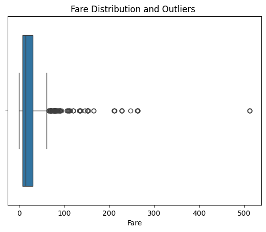 | 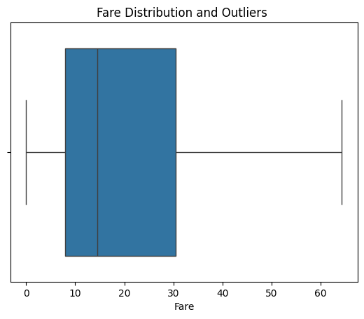 |

Avant l'écrêtage, plusieurs tarifs de passagers dépassaient 200 et 500, créant une queue à droite extrême. L'écrêtage ramène ces points extrêmes à la limite statistique supérieure sans rejeter les enregistrements.

#### Distribution de l'âge (Avant vs. Après écrêtage)

| Avant traitement des valeurs aberrantes | Après traitement des valeurs aberrantes |
| :---: | :---: |
| 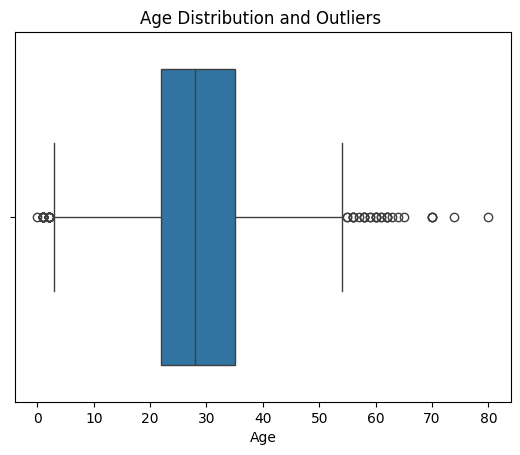 | 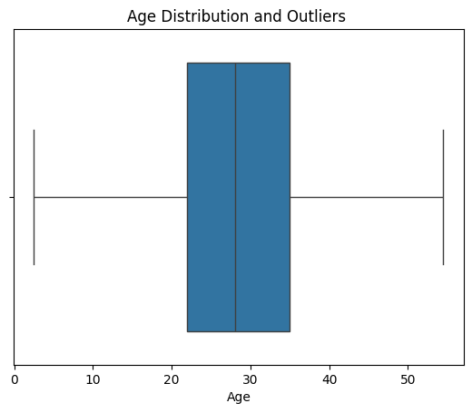 |

Les âges extrêmes de la queue supérieure ont été bornés tout en préservant la dispersion démographique principale.

#### Caractéristiques familiales : SibSp et Parch

| Caractéristique | Avant Écrêtage | Après Écrêtage |
| :--- | :---: | :---: |
| **SibSp** | 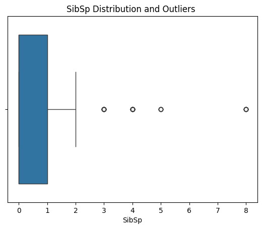 | 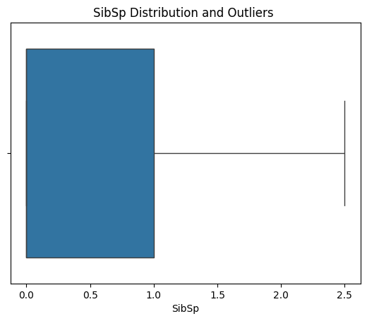 |
| **Parch** | 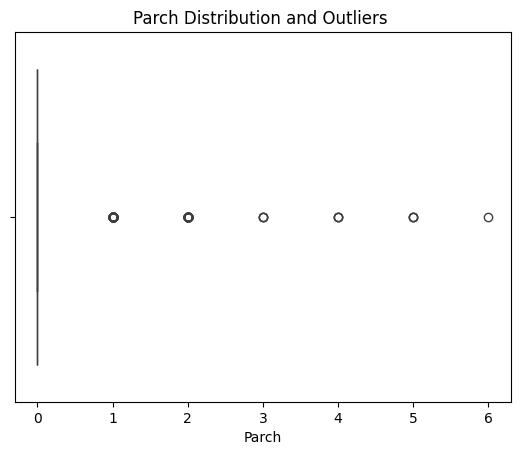 | 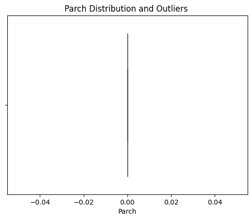 |

---

### 3. Transformation et mise à l'échelle des caractéristiques

#### Encodage catégoriel
Les algorithmes de Machine Learning fonctionnent sur des tenseurs numériques. Les attributs catégoriels ont été convertis à l'aide de l'encodage One-Hot (`pd.get_dummies`) :
- `Sex` : Converti en colonnes binaires factices (`Sex_female`, `Sex_male`).
- `Embarked` : Converti en indicateurs binaires (`Embarked_C`, `Embarked_Q`, `Embarked_S`).

#### Mise à l'échelle et normalisation
Les caractéristiques ont des unités et des ordres de grandeur fondamentalement différents. Deux techniques de mise à l'échelle complémentaires ont été évaluées :
- **Normalisation Min-Max** : Appliquée au tarif (`Fare`) pour compresser strictement les valeurs dans l'intervalle `[0, 1]`.
- **Standardisation (Z-Score)** : Appliquée à l'âge (`Age`) pour centrer la distribution autour d'une moyenne de 0 avec un écart-type unitaire (variance = 1).

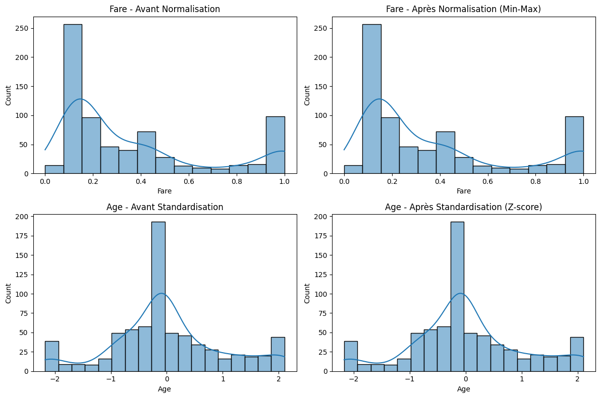

La visualisation comparative ci-dessus démontre l'effet des deux transformations :
- Les panneaux de gauche montrent les distributions des caractéristiques brutes avant transformation.
- Les panneaux de droite montrent les représentations mises à l'échelle, rendant les caractéristiques comparables pour les algorithmes basés sur le gradient ou la distance, tels que la Régression Logistique, les SVM et les KNN.

---

### 4. Gestion des classes déséquilibrées avec SMOTE

Dans le dataset brut du Titanic, la survie des passagers est inégalement répartie : environ 61 % des passagers n'ont pas survécu, contre 39 % qui ont survécu. Lorsque les modèles s'entraînent sur des cibles biaisées, ils développent souvent un biais en faveur de la prédiction de la classe majoritaire.

Pour y remédier, la technique SMOTE (Synthetic Minority Over-sampling Technique) a été appliquée à l'ensemble d'entraînement. Plutôt qu'un simple échantillonnage en double, SMOTE synthétise de nouveaux exemples plausibles de la classe minoritaire le long des vecteurs de l'espace des caractéristiques reliant les k-plus proches voisins.

#### Comparaison de la distribution des classes

| Avant SMOTE (Déséquilibré) | Après SMOTE (Équilibré) |
| :---: | :---: |
| 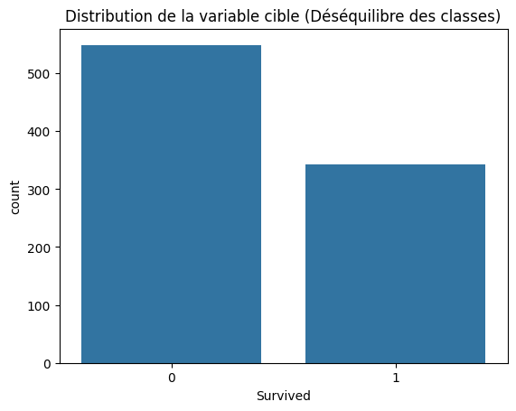 | 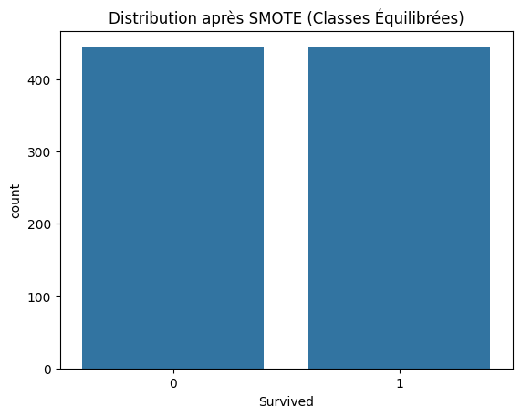 |

Comme le montrent les graphiques, SMOTE égalise la représentation des classes, fournissant une base non biaisée pour l'évaluation des modèles et le calcul des métriques (telles que le score F1, la précision et le rappel).

## Pour commencer

## Conclusion

Ce pipeline de prétraitement démontre les étapes essentielles requises pour préparer des données tabulaires brutes à la modélisation prédictive :
1. Gestion des valeurs manquantes adaptée à la distribution des caractéristiques et au pourcentage de valeurs nulles.
2. Écrêtage IQR pour atténuer l'influence des valeurs aberrantes extrêmes sans perdre de volume d'échantillons.
3. Encodage catégoriel approprié et techniques de mise à l'échelle adéquates (Min-Max vs. Standard Scaler).
4. Traitement du déséquilibre de la cible à l'aide d'un sur-échantillonnage synthétique via SMOTE.
